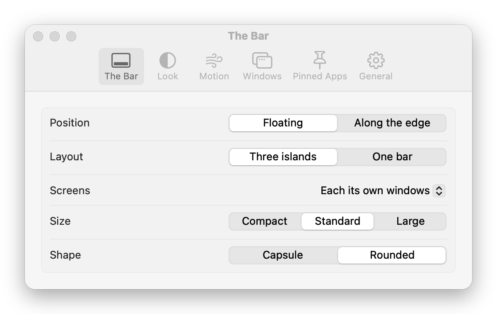

<div align="center">
  
  <h1>Leiste</h1>
  <p><b>A task bar for the Mac.</b><br>The windows of the desktop you're on, one click away.</p>
  <p>
    <a href="https://github.com/mjohanning99/leiste/releases/latest"></a>
    
    
    <a href="LICENSE"></a>
  </p>
</div>


**The Dock thinks in apps. Leiste thinks in windows.** 🪟

Say Firefox is open on desktop 1 and you're on desktop 2. Click it in the Dock and macOS whisks you back to desktop 1. Click it in Leiste and you get a new Firefox window right here. Each desktop keeps its own windows, like the task bar in KDE Plasma. The bar only shows the ones in front of you.

*A Leiste is a strip or a ledge. In German, a task bar is a Taskleiste.*

## ✨ What it does

|  |  |
|---|---|
| 🪟 **One desktop at a time** | A button for every window here. Switch desktops and the bar follows. |
| 📌 **Pinned apps** | Open a new window *on this desktop*, even if the app has windows elsewhere. |
| 🔴 **Badges** | The Dock's red badges, for the apps you choose. |
| 🟠 **Attention** | A window that wants you glows softly. A 🔊 shows who's playing sound. |
| 🔢 **Desktops** | Click a number to switch, or scroll over them. Drag a window onto a number to send it there. |
| 🧞 **Minimise into the bar** | Windows pour into their button like a magic lamp. Or use the Dock as usual. |
| 🗂️ **Groups** | Windows of one app can share a button when the bar fills up. |
| 🎈 **Small movements** | Buttons lift as you drag them, badges pop in, pinned apps hop. Turn it down or off. |
| 🫧 **Looks like macOS** | Liquid Glass, light and dark mode, a dozen ways to style it. |
| 🖥️ **Every screen** | Each screen gets its own bar with its own windows. |
| 🌍 **English and German** | Plus VoiceOver for every button. |
| 🔒 **Private and light** | No internet connection, ever. Well under 1 % of the processor. |

## 📦 Install

1. Download the **zip** from the [latest release](https://github.com/mjohanning99/leiste/releases/latest).
2. Unzip it and move **Leiste.app** to Applications.
3. Open it. A welcome window walks you through the rest. ✅

Needs **macOS 14** or later. The glass needs **macOS 26**; older versions get frosted glass instead.

<details>
<summary>⚠️ <b>macOS says it can't check Leiste for malicious software</b></summary>

<br>

Leiste isn't signed by a registered Apple developer, so macOS asks the first time. Click **Done**, then open **System Settings → Privacy & Security**, scroll down and click **Open Anyway** next to Leiste.

Or, from the terminal: `xattr -dr com.apple.quarantine /Applications/Leiste.app`
</details>

<details>
<summary>🛠️ <b>Build it yourself</b></summary>

<br>

All you need is Apple's Command Line Tools (`xcode-select --install`). No Xcode.

```sh
git clone https://github.com/mjohanning99/leiste
cd leiste
tools/build.sh
open build/Leiste.app
```

**Rebuilding often?** macOS ties the Accessibility permission to the app's signature, which changes with every build. Create a code-signing certificate in Keychain Access (**Certificate Assistant → Create a Certificate…**, type **Code Signing**) and put its name in a file called `.signing-identity`. `tools/build.sh` signs with it from then on and the permission stays.
</details>

## 🚀 First steps

The welcome window ticks these off as you go:

- [ ] 🔐 **Allow Accessibility**, so Leiste can see your windows.
- [ ] ⬅️ **Move the Dock to the side and hide it** (System Settings → Desktop & Dock), so it doesn't pop up over the bar.
- [ ] 🚫 **Stop macOS jumping between desktops**: in the same place, turn off *When switching to an application, switch to a Space with open windows*.
- [ ] ⚡ **Optional:** turn on *Switch to Desktop 1, 2, …* (Keyboard → Keyboard Shortcuts → Mission Control) for instant switching.
- [ ] 📌 **Pin your apps**: right-click a window → **Pin to the Bar**.

## 🖱️ Using it

| Do this | To |
|---|---|
| **Click** a window | Bring it forward. Click again to minimise. |
| **Click** a pinned app | Open a new window of it here. |
| **Middle-click** any button | The same: a new window here. |
| **Right-click** a button | Minimise, close, move to another desktop, pin, badges, quit. |
| **Drag** a button | Reorder it, or drop it on a desktop number. |
| **Scroll** over the desktops | Go one desktop left or right. |
| **⌃⌥1** to **⌃⌥9** | Bring the first to ninth window forward. |

## ⚙️ Settings

Right-click an empty part of the bar → **Leiste Settings…**. Changes show at once.

<p align="center">
  
  &nbsp;
  
</p>

| | |
|---|---|
| 🧱 **The Bar** | Floating or along the edge · islands or one bar · size · shape · screens |
| 🎨 **Look** | Glass · rim · the window in front · separators · the desktop switcher · menu symbols |
| 🎈 **Motion** | Full, reduced or off · each movement on its own |
| 🪟 **Windows** | Grouping · drop on a desktop · attention glow · sound · minimise into the Dock or the bar |
| 📌 **Pinned Apps** | Add, remove, reorder · whose badges to show |
| ⚙️ **General** | Start with the Mac · welcome window · reset to defaults |

<details>
<summary>📝 <b>The settings files</b></summary>

<br>

Everything lives as plain text in `~/Library/Application Support/Leiste/`:

- `launchers.txt`: pinned apps, one bundle identifier per line (find one with `osascript -e 'id of app "Safari"'`).
- `badges.txt`: apps whose badges you want.
- `options.txt`: everything from the Settings window.

Restart Leiste after editing the first two by hand.
</details>

## ❓ FAQ

<details>
<summary><b>It says it needs Accessibility, but I've allowed it.</b></summary>

<br>

After an update, macOS can hold on to the old permission. In **Privacy & Security → Accessibility**, remove Leiste with **−** and add it again with **+**.
</details>

<details>
<summary><b>Clicking a desktop number does nothing.</b></summary>

<br>

Leiste switches desktops by pressing macOS's own shortcuts. Turn on **Move left a space** and **Move right a space** (or **Switch to Desktop n**) in **Keyboard Shortcuts → Mission Control**.
</details>

<details>
<summary><b>A pinned app opens its window on another desktop.</b></summary>

<br>

Right-click the app in the Dock and set **Options → Assign To** to **None**.
</details>

<details>
<summary><b>The Dock pops up over the bar.</b></summary>

<br>

Move the Dock to the left or right side of the screen (see [First steps](#-first-steps)).
</details>

<details>
<summary><b>How does it move a window to another desktop?</b></summary>

<br>

macOS doesn't let apps move windows between desktops, but a window you're dragging goes along when you switch. So Leiste does what your hand would: it grabs the title bar, switches desktops and lets go. You go along with the window. Full-screen windows can't be moved this way.
</details>

<details>
<summary><b>Switching with the keyboard or trackpad shows up a moment late.</b></summary>

<br>

macOS only announces a new desktop once its slide is over, about a second later. Clicking or scrolling on Leiste's switcher changes the bar at once.
</details>

<details>
<summary><b>Where's the log?</b></summary>

<br>

`~/Library/Logs/Leiste.log`. Attach it to an issue if something misbehaves.
</details>

<details>
<summary>🔍 <b>How it works</b></summary>

<br>

Leiste is a small Swift app (AppKit and SwiftUI) with no dependencies. It rests while the screen sleeps and uses about 60 MB of memory.

- **It listens instead of asking.** Apps announce through the Accessibility API when a window opens, closes or changes. Only then does the bar look again.
- **The window server** says which windows are on this desktop; the Accessibility API gives their titles and raises, minimises and closes them.
- **Desktops** have no public API on the Mac, so Leiste uses a few undocumented calls that window managers have relied on for years ([`CGSPrivate.h`](Sources/CGSPrivate/include/CGSPrivate.h)). A macOS update could break them; please open an issue if it does.
- **New windows here:** Leiste sends the app ⌘N in the background, then brings the new window forward.
- **Badges** come from the Dock, which shares them even while hidden. **Sound** comes from Core Audio.
- **Minimise into the bar** isn't macOS's minimise. The window is tucked into the screen's corner while Leiste draws a stand-in pouring into the button (never a picture of your window, so no Screen Recording permission).
- **Windows reaching under the bar** are shortened to end just above it, since macOS can't reserve space for anything but the Dock.
</details>

<details>
<summary>🗑️ <b>Uninstalling</b></summary>

<br>

1. Right-click the bar → **Quit Leiste**. Move **Leiste.app** to the Bin.
2. Delete `~/Library/Application Support/Leiste` and `~/Library/Logs/Leiste.log`.
3. Remove Leiste from **Privacy & Security → Accessibility** and from **General → Login Items**.
4. Move the Dock back if you like.
</details>

## 🤝 Contributing

Bug reports, ideas and pull requests are welcome. For anything big, open an issue first so we can agree on the approach.

About 4,300 lines of Swift in small files that each explain themselves. Start with [`BarModel.swift`](Sources/Leiste/BarModel.swift): it holds what the bar knows and a map of everything else. `Leiste --snapshot bar.png` draws the bar with made-up windows; `--settings-snapshot folder` draws the Settings tabs. What changed when is in the [changelog](CHANGELOG.md).

## 📄 Licence

MIT. See [LICENSE](LICENSE).
