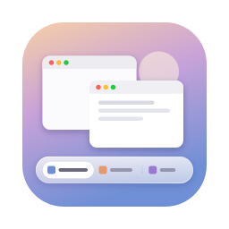
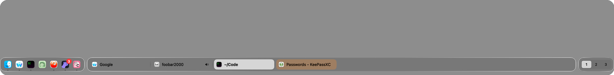
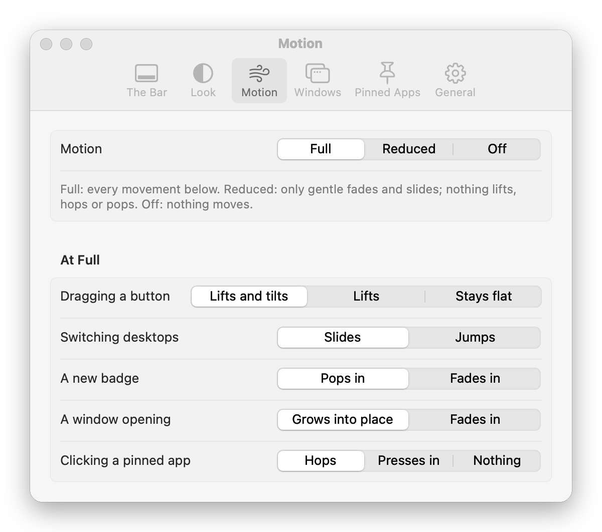

# Leiste

**A task bar for the Mac: the windows of the desktop you're on, one click away.**

Leiste is a bar along the bottom of your screen that works like the task bar in KDE Plasma. It shows a button for every window on the current desktop, opens new windows where you are instead of sending you off to another desktop and switches desktops with a click. It's built from the Mac's own Liquid Glass, so it looks as if it came with macOS.

*A Leiste is a strip or a ledge. In German, a task bar is a Taskleiste.*



- [Why?](#why)
- [Features](#features)
- [Installing](#installing)
- [First steps](#first-steps)
- [Using it](#using-it)
- [Settings](#settings)
- [How it works](#how-it-works)
- [FAQ and troubleshooting](#faq-and-troubleshooting)
- [Uninstalling](#uninstalling)
- [Contributing](#contributing)
- [License](#license)

## Why?

The Dock thinks in apps; Leiste thinks in windows. Say Firefox is open on desktop 1 and you're on desktop 2. Click Firefox in the Dock and macOS takes you back to desktop 1. Click it in Leiste and you get a new Firefox window right here, on desktop 2, the way it works on Linux. Each desktop keeps its own windows. The bar only ever shows the ones in front of you.

## Features

**Windows, one desktop at a time**

- A button for every window on the current desktop, with its icon and title. Switch desktops and the bar follows.
- Click a window to bring it forward. Click the one in front to minimise it. Minimised windows stay on the bar, faded, on the desktop they came from.
- Minimise into the Dock as usual, or into Leiste: the window pours into its own button on the bar like a magic lamp (or simply shrinks) and grows back out of it. A window's own yellow button does the same.
- Windows of one app can share a button: never, always, or only when the bar gets full. A group shows how many windows it has. Click it again and again to cycle through them.
- Drag buttons to put them in the order you like. A button lifts out of the bar as you drag it and the others make room.
- Drag a window's button onto a desktop number to send the window there (you go along with it). Or right-click it and choose **Move to Desktop**.

**Pinned apps that open windows where you are**

- Pin the apps you use most. A click opens a new window of that app on the desktop you're on, even when the app already has windows on another desktop.
- A middle click (pressing the mouse wheel) on any button does the same.
- A dot under a pinned app that's open, as on the Dock.

**What needs you**

- The red badges from the Dock (unread messages, mail), for the apps you choose.
- A window that asks for your attention glows a soft orange until you look at it.
- A small speaker on the button of any app that's playing sound.

**Desktops**

- A desktop switcher at the right end: a segmented switch, plain numbers, dots, or little pictures of each desktop and its windows.
- The scroll wheel over the switcher moves between desktops.
- Control-Option-1 to 9 brings the first to ninth window forward.
- Right-click any button for its menu: new window, minimise, close, move to another desktop, pin, badges, quit. Each item has a symbol, as in macOS's own menus.

**Looks like it belongs**

- Liquid Glass on macOS 26 and later, clear or frosted, as see-through or as solid as you like, with a bright rim along its edge. Light and dark mode follow the system.
- Floating in three islands (pinned apps, windows, desktops), floating as one bar, or along the very edge of the screen like a classic panel.
- A bar on every screen, each with its own windows, if you have more than one.
- In English and German.
- Compact, standard or large, capsule or rounded, with six ways to separate the windows.
- Small movements: a dragged button lifts and leans, the desktop switcher's highlight slides, new badges pop in, new windows grow into place and pinned apps hop when clicked. Each one is a choice, or turn motion down to Reduced or Off. Nothing moves when Reduce Motion is on.
- The bar fades away while a full-screen app or video is in front. It comes back afterwards.
- Windows that a tiling tool or the green button stretches to the bottom of the screen stop just above the bar instead of under it.

<p align="center">
  
  &nbsp;
  
</p>

## Installing

You need a Mac with **macOS 14 or newer**, Apple silicon or Intel. The glass needs **macOS 26 or newer**; on older systems Leiste uses the frosted material instead. It's developed on macOS 27 on Apple silicon, which is where it's been tested most.

### 1. Download it

1. Download `Leiste-<version>.zip` from the [latest release](https://github.com/mjohanning99/leiste/releases/latest), unzip it and move **Leiste.app** to your Applications folder.
2. Open it. macOS will say it can't check it for malicious software, because Leiste isn't signed by a registered Apple developer. Click **Done**, then go to **System Settings → Privacy & Security**, scroll down and click **Open Anyway** next to Leiste.

If you'd rather, you can lift the warning from the terminal instead: `xattr -dr com.apple.quarantine /Applications/Leiste.app`.

### 2. Build it yourself

You need Apple's Command Line Tools (`xcode-select --install`). Xcode works too, but isn't needed.

```sh
git clone https://github.com/mjohanning99/leiste
cd leiste
tools/build.sh
open build/Leiste.app
```

The app is in `build/Leiste.app`. Move it to your Applications folder if you want to keep it.

**Rebuilding often?** macOS ties the Accessibility permission to the app's signature. A self-built app gets a new one with every build, so you'd have to grant the permission again each time. To avoid that, create a code-signing certificate in Keychain Access (**Certificate Assistant → Create a Certificate…**, type **Code Signing**) and put its name in a file called `.signing-identity` in the project folder. `tools/build.sh` signs with it from then on.

## First steps

The first time Leiste starts, a welcome window walks you through these steps and ticks each one off as you go. Here they are in full:

1. **Allow Accessibility.** Leiste asks the first time it starts. It needs this permission to see your windows, bring them forward and read the Dock's badges. If the request doesn't appear, open **System Settings → Privacy & Security → Accessibility**, click **+** and add Leiste.
2. **Hide the Dock and move it to the side.** In **System Settings → Desktop & Dock**, set **Position on screen** to **Left** or **Right** and turn on **Automatically hide and show the Dock**. A hidden Dock at the bottom would pop up over Leiste whenever the pointer touches the edge.
3. **Stop macOS jumping between desktops.** In the same place, turn off **When switching to an application, switch to a Space with open windows for the application**.
4. **Optional: jump straight to a desktop.** In **System Settings → Keyboard → Keyboard Shortcuts… → Mission Control**, turn on **Switch to Desktop 1**, **2** and so on. Leiste then jumps straight to the desktop you click instead of sliding through the ones in between.
5. **Pin your apps.** Right-click any window → **Pin to the Bar**, or add them in Settings.

Leiste adds itself to **Login Items**, so it's there after you log in. You can turn that off in its Settings.

## Using it

| | |
|---|---|
| **Click** a window | Bring it forward; minimise it if it's already in front; bring it back if it's minimised |
| **Click** a group | Bring its latest window forward; click again for the next |
| **Click** a pinned app | Open a new window of it on this desktop |
| **Middle-click** any button | Open a new window of that app on this desktop |
| **Right-click** a button | New window, minimise, close, move to another desktop, pin, badges, what a click opens and quit, plus the windows of a group |
| **Right-click** the bar | Settings and Quit |
| **Drag** a button | Move it |
| **Scroll** over the desktops | Move one desktop left or right |
| **Control-Option-1 to 9** | Bring the first to ninth window forward |

## Settings

Right-click an empty part of the bar and choose **Leiste Settings…**. Every change shows at once.

| Tab | Options |
|---|---|
| **The Bar** | Floating or along the edge · three islands or one bar · a bar on each screen (with its own windows or every window) or the main screen only · compact, standard or large · capsule or rounded |
| **Look** | Clear or frosted glass · how see-through · a faint line, a bright rim, or a rim and a soft glow along the edge · the window in front filled, raised, in your accent colour or underlined · fading lines, lines, dots, a pill for each window, a sunken tray or nothing between windows · a tint or a swell under the pointer · the desktop switcher · dots under open apps · symbols in menus |
| **Motion** | Full, reduced or off · how a dragged button lifts · whether the switcher slides · how badges and new windows appear · what a pinned app does when clicked |
| **Windows** | Grouping · dropping a window onto a desktop number · "No windows on this desktop" · the orange glow for windows that ask for you · the speaker for apps playing sound · minimise into the Dock or into Leiste (a window outline or a glass pane, as a magic lamp or a squash) |
| **Pinned Apps** | Add, remove and reorder them · whose badges to show, also for apps that aren't pinned |
| **General** | Starting with the Mac · the welcome window · the settings files · reset to defaults |

The settings are plain text files in `~/Library/Application Support/Leiste/`, so you can read and change them by hand too:

- `launchers.txt`: the pinned apps, one bundle identifier per line, left to right. Find an app's identifier with `osascript -e 'id of app "Safari"'`.
- `badges.txt`: the apps whose badges you want to see.
- `options.txt`: everything from the Settings window, one `name = value` per line.

Leiste reads `launchers.txt` and `badges.txt` when it starts, so restart it after editing them by hand. Changes made in Settings or from the bar's menus apply at once.

## How it works

Leiste is a small Swift app (AppKit and SwiftUI) with no dependencies. It never connects to the internet and collects nothing. It is light: at rest it uses well under 1 % of the processor and about 60 MB of memory. It rests completely while the screen is asleep or locked.

- It listens rather than asks: apps announce through the Accessibility API when a window opens, closes, moves, is retitled or minimised. Only then does the bar look again. A slow look every few seconds catches anything an app forgets to announce.

- It asks the window server which windows are on screen, which on the Mac means the windows of the current desktop. The Accessibility API supplies their titles and lets it raise, minimise and close them.
- macOS has no public way to ask which desktop a window is on, how many desktops there are or how to switch between them. For those, Leiste uses a few undocumented calls that window managers and bars for the Mac have relied on for years, listed in [`Sources/CGSPrivate/include/CGSPrivate.h`](Sources/CGSPrivate/include/CGSPrivate.h). To switch desktops it presses the system's own keyboard shortcuts for you. A macOS update could break any of this; if that happens, please open an issue.
- Badges come from the Dock, which shares them with accessibility tools even while it's hidden. An app asking for attention makes its Dock icon bounce. Leiste notices the icon moving out of line.
- Which apps are playing sound comes from Core Audio, which has listed that since macOS 14.2.
- To open a window on the desktop you're on, Leiste presses the app's own **New Window** menu item while the app stays in the background. Only then does it bring the new window forward.
- macOS gives no way to reserve space at the edge of the screen for anything but the Dock. So when a window reaches under the bar, Leiste shortens it to end just above.
- Minimising into Leiste isn't macOS's minimise, whose animation the Dock draws and always aims at the Dock. The window is moved out of sight into the screen's corner in one go. A stand-in that Leiste draws itself (never a picture of the window, so no Screen Recording permission) pours into the button. Mission Control shows a window minimised this way as a tiny one in the corner.

## FAQ and troubleshooting

**The bar says it needs the Accessibility permission, but I've given it.**
After an update or a rebuild, macOS can keep the old permission for an app that has since changed. Remove Leiste from the list in **Privacy & Security → Accessibility** with **−** and add it again with **+**.

**Clicking a desktop number does nothing.**
Leiste switches desktops by pressing the system's shortcuts. Check that **Move left a space** and **Move right a space** (or **Switch to Desktop n**) are turned on in **Keyboard Shortcuts → Mission Control**.

**A pinned app opens its new window on another desktop.**
Right-click the app's icon in the Dock and set **Options → Assign To** to **None**. An app assigned to one desktop always opens its windows there.

**The Dock appears over the bar.**
Move the Dock to the left or right side of the screen; see [First steps](#first-steps).

**Can it move a window to another desktop?**
Yes: right-click its button and choose **Move to Desktop**. macOS has no way for an app to move a window, but it carries a window along while you drag it and switch desktops. So Leiste does just that for you: it grabs the window by its title bar, switches desktops and lets go. You go along with the window. The pointer jumps to the window for a moment before going back. It's quickest with **Switch to Desktop 1, 2, …** turned on (see [First steps](#first-steps)). Windows in full screen can't be moved this way.

**Does it work with more than one screen?**
Yes: each screen gets a bar with its own windows. In Settings → The Bar → Screens you can have every window on each bar, or a bar on the main screen only.

**Switching desktops with the keyboard or trackpad takes a moment to show on the bar.**
macOS only announces a desktop change once its slide is over, about a second later. It also keeps its own keyboard shortcuts from apps. Clicking a desktop in Leiste, or scrolling over the switcher, changes the bar at once.

**Where's the log?**
`~/Library/Logs/Leiste.log` notes when Leiste opens new windows and switches desktops. It helps when something doesn't work as expected; attach it to an issue if you like.

## Uninstalling

1. Right-click an empty part of the bar and choose **Quit Leiste**.
2. Move **Leiste.app** to the Bin.
3. Delete its settings and log: `~/Library/Application Support/Leiste` and `~/Library/Logs/Leiste.log`.
4. In **System Settings → Privacy & Security → Accessibility**, select Leiste and click **−**.
5. In **System Settings → General → Login Items**, remove Leiste if it's still listed.

Then move the Dock back to the bottom if you like. You may also want to turn **Automatically hide and show the Dock** off again.

## Contributing

Bug reports, ideas and pull requests are welcome. Please open an issue first for anything big, so we can agree on the approach before you spend time on it.

Leiste is about 4,300 lines of Swift with no dependencies, in small files that each do one thing and start by explaining it. [`Sources/Leiste/BarModel.swift`](Sources/Leiste/BarModel.swift) is the place to start: it holds what the bar knows and a map of where everything else lives. `tools/build.sh` builds it; `build/Leiste.app/Contents/MacOS/Leiste --snapshot bar.png` draws the bar with made-up windows into a picture, handy for checking a layout without a screenshot (add `--dark`, or `--opt name=value` with the names from `options.txt`). `--settings-snapshot folder` draws each tab of the Settings window.

What changed in each version is in [CHANGELOG.md](CHANGELOG.md).

## License

MIT, see [LICENSE](LICENSE).
